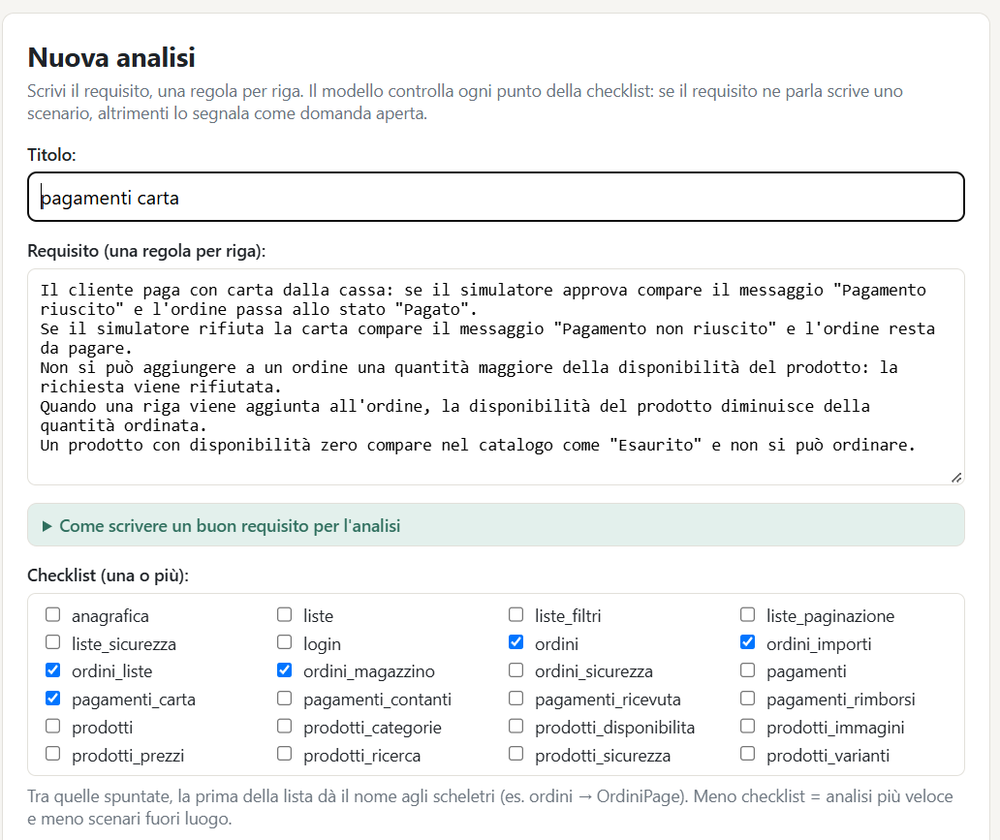
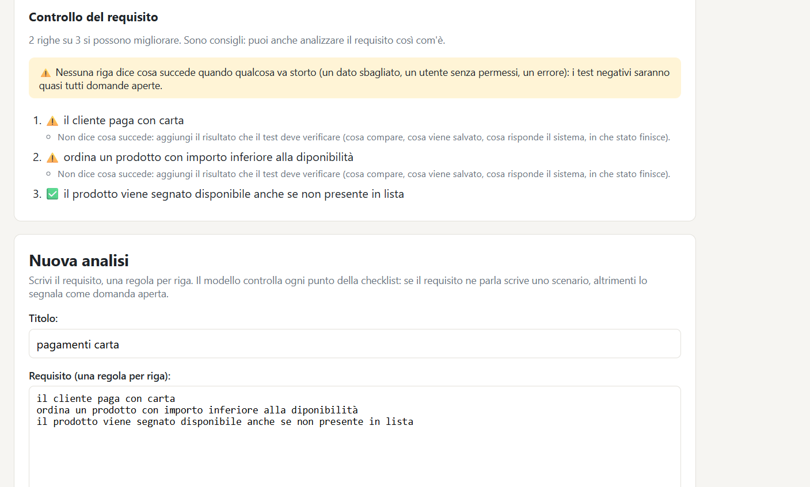
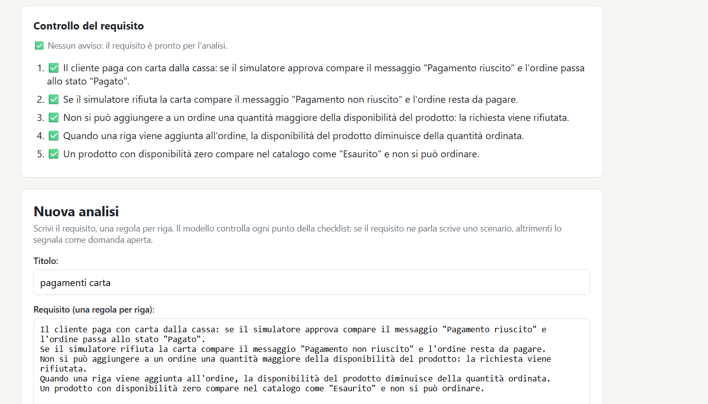
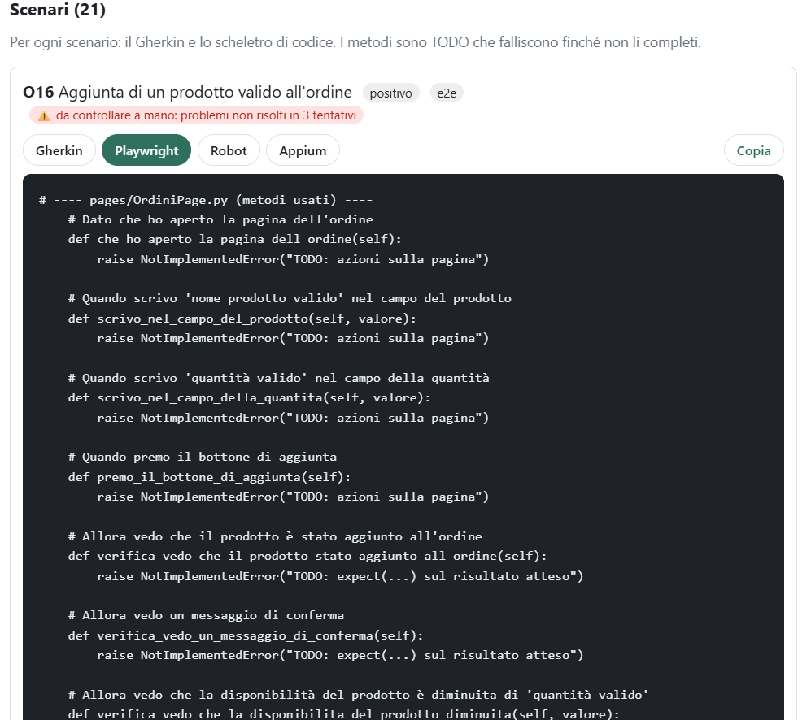
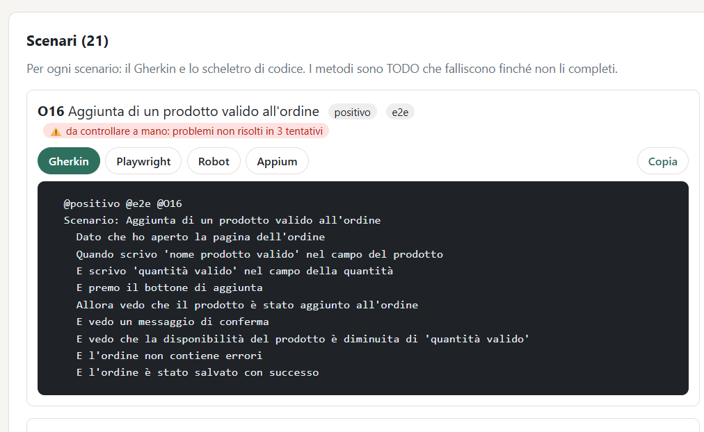

# QA Scenari AI

**Dal requisito agli scenari di test, con un modello AI piccolo che gira sul mio computer.**

Scrivo un requisito, una regola per riga, e scelgo le checklist dell'area (login, ordini, pagamenti…).
Il programma, con **Ollama** e il modello **`qwen2.5:3b`** in locale (gratis, senza API key), restituisce:

1. **scenari Gherkin** in italiano, ognuno con tipo, livello della piramide e codice del punto della checklist;
2. **domande aperte** per i punti di cui il requisito non parla (invece di inventare il comportamento);
3. **scheletri di codice** per ogni scenario in **Playwright** (Python), **Robot Framework** e **Appium** (Java).

È un progetto per imparare a **gestire un'AI**, non solo a usarla: prompt con regole ed esempi, risposte in JSON con schema,
controlli automatici con ciclo di correzione e, soprattutto, **misure** per decidere quale versione del prompt tenere.



> Gli scenari sono una **bozza** da rivedere, non test pronti: è un aiuto per partire, la revisione resta della tester.

---

## Indice

1. [Il risultato più importante](#1-il-risultato-più-importante)
2. [Come funziona](#2-come-funziona)
3. [Un esempio completo](#3-un-esempio-completo)
4. [Le checklist](#4-le-checklist)
5. [Come ho migliorato i prompt (con i numeri)](#5-come-ho-migliorato-i-prompt-con-i-numeri)
6. [I controlli automatici](#6-i-controlli-automatici)
7. [L'aiuto a scrivere il requisito](#7-laiuto-a-scrivere-il-requisito)
8. [Limiti](#8-limiti)
9. [Come avviarlo](#9-come-avviarlo)
10. [Struttura del progetto](#10-struttura-del-progetto)
11. [Cosa ho imparato](#11-cosa-ho-imparato)

---

## 1. Il risultato più importante

**La qualità del requisito pesa più del prompt.**

Stessa analisi, stesse 5 checklist (94 punti), stesso modello e stessi prompt. Cambia solo il modo in cui è scritto il requisito:

| | Requisito vago | Requisito scritto bene |
|---|---|---|
| Righe | 3 | 5 |
| Scenari scritti | **4** | **21** |
| Domande aperte | 90 | 73 |
| Scenari usabili (revisione mia) | ~0 | **~12** |
| Testi presi dal requisito | 0 | 7 scenari (`'Pagamento riuscito'`, `'Pagamento non riuscito'`, `'Pagato'`) |
| Dettagli inventati | "il saldo del conto aumentato", `'Pagamento completato'` | quasi nessuno |

**Requisito vago**: il bottone *Controlla il requisito* segnala 2 righe su 3.



**Requisito scritto bene**: nessun avviso.



Per confronto, il miglioramento più grande ottenuto cambiando il **prompt** è stato da 22 a 26 decisioni giuste su 32 (v3 → v4).
Riscrivere il **requisito** ha portato gli scenari usabili da circa 0 a circa 12.
Per questo nel programma c'è anche un [aiuto a scrivere il requisito](#7-laiuto-a-scrivere-il-requisito).

---

## 2. Come funziona

Un punto della checklist alla volta, in tre passi (*prompt chaining*). Provare a fare tutto in una sola chiamata
(prompt v1) dava risposte tagliate e **0 citazioni vere** del requisito: per questo è stata scartata.

```
requisito (una regola per riga)  +  checklist scelte (es. pagamenti, pagamenti_carta)
        │
        ▼
[Python]  numera le righe del requisito, legge i punti della checklist
        │
        ▼   per ogni punto (es. PAY24 "Carta rifiutata: messaggio e possibilità di riprovare")
[AI]  PASSO A  – prompts/v4_decidi.md
      "Quale riga del requisito parla di questo punto? 0 = nessuna"
      risposta JSON con lista chiusa: {"riga": 2}
        │
        ├── riga 0  →  DOMANDA APERTA (il requisito non dice cosa succede)
        │
        └── riga N  →  [AI] PASSO B – prompts/s3_scenario.md + esempio della checklist
                       scrive lo scenario in JSON: livello, titolo, dato, quando, allora
                         │
                         ▼
                       [Python] controlli di forma → se c'è un problema, lo rimanda all'AI
                                (ciclo di correzione, al massimo 3 tentativi)
                         │
                         ▼
                       [Python] Gherkin  +  PASSO C: scheletri Playwright / Robot / Appium
                                (senza AI: sempre corretti)
```

Le scelte importanti, e perché:

| Scelta | Perché |
|---|---|
| L'AI risponde in **JSON con schema** (Pydantic + `format=` di Ollama) | la risposta ha sempre la forma giusta; i campi come il livello sono **liste chiuse** (`Literal`) |
| Il **tipo** dello scenario lo copia Python dalla checklist | nelle prime prove l'AI sbagliava quasi sempre il tipo |
| Il **Gherkin** lo scrive Python dal JSON | la sintassi è sempre corretta |
| Gli **scheletri** li scrive Python, senza AI | un modello da 3B inventerebbe metodi e selettori; ogni metodo è un TODO che **fallisce apposta** (niente falsi verdi) |
| **Domanda aperta** invece di comportamento inventato | è quello che fa una tester con un requisito incompleto: chiede al product owner |
| Un **esempio per checklist e per livello** | un modello piccolo scrive come l'esempio: con un esempio di form scrive anche gli scenari API come un form |

Lo schema che obbliga la forma della risposta, per esempio nel passo A (`generatore/schemas.py`):

```python
def schema_riga(numero_righe: int) -> type[BaseModel]:
    """Passo A con righe numerate: l'AI sceglie SOLO un numero di riga (0 = nessuna riga ne parla)."""
    Riga = Literal[tuple(range(numero_righe + 1))]  # es. Literal[0, 1, 2, ..., 8]
    return create_model(
        "DecisioneRiga",
        riga=(Riga, Field(description="Numero della riga che parla del punto, 0 se nessuna")),
    )

# generatore/decidi.py
risposta = ollama.chat(
    model="qwen2.5:3b",
    messages=[{"role": "user", "content": prompt}],
    format=schema_riga(len(righe)).model_json_schema(),   # il modello non può rispondere "riga 12" se le righe sono 8
    options={"temperature": 0, "num_ctx": 4096, "num_predict": 300},
)
```

---

## 3. Un esempio completo

**Riga del requisito**

```
Se il simulatore rifiuta la carta compare il messaggio "Pagamento non riuscito" e l'ordine resta da pagare.
```

**Passo A**: il punto *PAY24 – Carta rifiutata: messaggio comprensibile e possibilità di riprovare* → riga 2.

**Passo B**: lo scenario (usa il testo esatto del requisito):

```gherkin
  @negativo @e2e @PAY24
  Scenario: Messaggio di carta rifiutata e possibilità di riprovare
    Dato che il simulatore è impostato per rifiutare la carta
    E che ho aperto la schermata di pagamento dell'ordine del tavolo '7'
    Quando premo il bottone Paga con carta
    Allora vedo il messaggio 'Pagamento non riuscito'
    E vedo il bottone Riprova
```

**Passo C**: gli scheletri. I valori tra apici diventano parametri, così i metodi si riusano tra scenari.

<details>
<summary><b>Playwright (pytest, page object)</b></summary>

```python
# pages/PagamentiPage.py
    # Quando premo il bottone Paga con carta
    def premo_il_bottone_paga_con_carta(self):
        raise NotImplementedError("TODO: azioni sulla pagina")

    # Allora vedo il messaggio 'Pagamento non riuscito'
    def verifica_vedo_il_messaggio(self, valore):
        raise NotImplementedError("TODO: expect(...) sul risultato atteso")

# tests/test_pagamenti.py
    @pytest.mark.negativo
    @pytest.mark.e2e
    @pytest.mark.PAY24
    def test_PAY24_messaggio_di_carta_rifiutata_e_possibilita_di_riprovare(self, page):
        pagamenti = PagamentiPage(page)
        pagamenti.che_il_simulatore_impostato_per_rifiutare_la_carta()
        pagamenti.che_ho_aperto_la_schermata_di_pagamento_dell_ordine('7')
        pagamenti.premo_il_bottone_paga_con_carta()
        pagamenti.verifica_vedo_il_messaggio('Pagamento non riuscito')
        pagamenti.verifica_vedo_il_bottone_riprova()
```
</details>

<details>
<summary><b>Robot Framework (Browser Library)</b></summary>

```robotframework
# resources/pagamenti_page.resource
Verifica Vedo Il Messaggio
    [Documentation]    Allora vedo il messaggio 'Pagamento non riuscito'
    [Arguments]    ${valore}
    Fail    TODO: verifica il risultato atteso

# tests/pagamenti.robot
PAY24 Messaggio di carta rifiutata e possibilità di riprovare
    [Tags]    negativo    e2e    PAY24
    Che Il Simulatore Impostato Per Rifiutare La Carta
    Che Ho Aperto La Schermata Di Pagamento Dell Ordine    7
    Premo Il Bottone Paga Con Carta
    Verifica Vedo Il Messaggio    Pagamento non riuscito
    Verifica Vedo Il Bottone Riprova
```
</details>

<details>
<summary><b>Appium (Java, TestNG)</b></summary>

```java
// pages/PagamentiPage.java
    // Allora vedo il messaggio 'Pagamento non riuscito'
    public boolean verificaVedoIlMessaggio(String valore) {
        throw new UnsupportedOperationException("TODO: controlla il risultato atteso");
    }

// tests/PagamentiTest.java
    @Test(groups = {"negativo", "e2e", "PAY24"},
          description = "Messaggio di carta rifiutata e possibilità di riprovare")
    public void PAY24_messaggioDiCartaRifiutataEPossibilitaDiRiprovare() {
        pagamenti.cheIlSimulatoreImpostatoPerRifiutareLaCarta();
        pagamenti.cheHoApertoLaSchermataDiPagamentoDellOrdine("7");
        pagamenti.premoIlBottonePagaConCarta();
        assertTrue(pagamenti.verificaVedoIlMessaggio("Pagamento non riuscito"),
                "Non verificato: vedo il messaggio 'Pagamento non riuscito'");
        assertTrue(pagamenti.verificaVedoIlBottoneRiprova(),
                "Non verificato: vedo il bottone Riprova");
    }
```
</details>

La pagina dei risultati mostra ogni scenario con le linguette **Gherkin / Playwright / Robot / Appium** e il bottone *Copia*;
si scaricano il `.feature` e uno zip con gli scheletri completi.



*Nella schermata c'è apposta uno scenario debole (O16, con valori segnaposto come 'quantità valido'):
il programma non lo nasconde, lo segna in rosso come* da controllare a mano *(vedi [i controlli](#6-i-controlli-automatici)).*

---

## 4. Le checklist

Le checklist sono la parte di **esperienza da QA** del progetto: per ogni area, cosa va controllato, con tipo e livello.
Sono file markdown in `checklist/`: una nuova checklist compare da sola nel form.

```markdown
| # | Cosa controllare | Tipo | Livello |
|---|---|---|---|
| PAY23 | Carta simulata rifiutata: il pagamento non risulta completato | negativo | api |
| PAY24 | Carta rifiutata: messaggio comprensibile e possibilità di riprovare, se prevista | negativo | e2e |
```

**24 checklist, 431 punti**, divise per sezione così si spuntano solo quelle che servono:

| Area | File | Punti |
|---|---|---|
| Login | `login` | 32 |
| Anagrafica | `anagrafica` | 55 |
| Ordini | `ordini`, `ordini_importi`, `ordini_magazzino`, `ordini_liste`, `ordini_sicurezza` | 91 |
| Prodotti e catalogo | `prodotti`, `prodotti_prezzi`, `prodotti_categorie`, `prodotti_varianti`, `prodotti_disponibilita`, `prodotti_ricerca`, `prodotti_immagini`, `prodotti_sicurezza` | 107 |
| Pagamenti | `pagamenti`, `pagamenti_contanti`, `pagamenti_carta`, `pagamenti_rimborsi`, `pagamenti_ricevuta` | 68 |
| Liste e ricerca (trasversale) | `liste`, `liste_filtri`, `liste_paginazione`, `liste_sicurezza` | 78 |

- **Tipi**: positivo, negativo, limite, sicurezza, accessibilità. **Livelli**: unit, api, e2e.
- Le aree **non si ripetono**: per esempio lo stock modificato dagli ordini sta in `ordini_magazzino`, quello modificato a mano in `prodotti_disponibilita`.
- Le note importanti stanno **dentro il testo del punto**, perché il modello vede solo quello:
  *"Timeout del servizio di pagamento: stato gestito senza presumere che la transazione sia fallita"*.
- Ogni checklist ha un **esempio di scenario per livello** (`## Esempio di scenario api`, `## Esempio di scenario e2e`…) e Python passa al modello quello giusto.
- Una checklist scritta male ferma il programma: riga senza tipo o livello, tipo non ammesso, codice ripetuto tra due file.

---

## 5. Come ho migliorato i prompt (con i numeri)

Il riferimento è il mio file `riferimenti/login.feature`: scenari scritti a mano, con i tag `@L3 @riga5` che dicono quale
punto e quale riga del requisito si aspettano. Python confronta le risposte dell'AI e conta:
✅ decisione e riga giuste · ⚠️ riga sbagliata · ❌ decisione sbagliata.

```
python -m generatore.decidi requisiti/login.txt --prompt v4 --ripetizioni 5
```

### Passo A: quale riga parla del punto?

| Versione | Idea | Decisioni giuste (su 32) | Con la riga giusta | Esito |
|---|---|---|---|---|
| v1 | tutti i punti in una chiamata | – | 0 citazioni vere | scartata |
| v2 | cita la frase del requisito, Python verifica che esista | 21 | – | prudente |
| v3 | righe numerate, risposta = numero (lista chiusa) | 22 | 20,2 (4 punti instabili) | troppo generosa: "parole simili" |
| **v4** | v3 + regola contro le parole simili | **26** | **23 (0 instabili su 5 giri)** | **scelta** |
| v5 | v4 + "una riga che dice cosa è permesso parla anche del caso vietato" | 10 | 8 | **bocciata**: dice "sì" a 31 punti su 32 |

Quello che ho scoperto misurando:
- **Una misura sola non basta.** Anche con `temperature: 0` le risposte cambiavano quando Ollama ricaricava il modello: ho aggiunto `--ripetizioni` (che scarica il modello tra un giro e l'altro) e il conteggio dei **punti instabili**, come per i test flaky.
- **Una metrica troppo generosa inganna.** All'inizio contavo solo "sì/no": 3 decisioni "giuste" avevano la riga sbagliata. Da lì il tag `@rigaN` nel riferimento.
- **Due regole opposte non stanno insieme** in un modello da 3B: la v5 ha cancellato la regola della v4. Resta la v4.

### Passo B: scrivere lo scenario

| Versione | Cosa cambia | Effetto |
|---|---|---|
| s1 | solo le regole | "Dato nome", codice dentro il Gherkin, "Allora verifica che…" |
| s2 | 7 regole + un esempio (il mio scenario L3) | forma molto migliore, ma copia l'esempio del login anche nell'anagrafica |
| **s3** | l'esempio sta nella **checklist dell'area**, regola "non copiare l'esempio" | niente contaminazione tra aree, passi con valori concreti e riutilizzabili |
| s3 + esempio per livello | esempio `api` separato da quello del form | i 7 scenari `@api` scritti come un form sono diventati **7 su 7** richiesta/risposta; gli altri scenari **identici parola per parola** (esperimento con una variabile sola) |

Il form usa sempre la versione migliore misurata (v4 + s3). Le altre restano in `prompts/` come storia degli esperimenti
e si possono scegliere sotto *Opzioni avanzate*.

---

## 6. I controlli automatici

Ogni scenario passa da `generatore/controlli.py`. Se c'è un problema di **forma**, il messaggio torna all'AI che riscrive
(al massimo 3 tentativi): la pagina mostra *🔁 corretto N×*. Se resta sbagliato, lo segna in rosso: *da controllare a mano*.



```python
problemi = controlla_scenario(dato, quando, allora, riga=testo_riga, tipo="negativo", livello="api")
# ['"quando": il passo "ho aperto la pagina Nuovo prodotto" descrive l'interfaccia ("aperto la pagina"),
#   ma il livello è api: scrivi la richiesta ("invio la richiesta di ... con ...") e la risposta (...)']
```

| Controllo | Esempio bloccato |
|---|---|
| Codice o simboli nel Gherkin | `@api.azienda.partita_iva = '123'` |
| Passo troppo corto o troppo lungo, passi ripetuti | "Dato nome" |
| "Allora verifica che…" | si scrive cosa si vede o cosa risponde il sistema |
| Valore segnaposto | `scrivo '...' nel campo` |
| Testo di un messaggio inventato (non è nella riga) | `'Lo stato dell'ordine non può essere aggiornato…'` |
| Valore uguale al nome del campo | `scrivo 'Quantità' nel campo 'Quantità'` |
| Positivo che finisce con un errore | positivo + "vedo un messaggio di errore" |
| `@api` scritto come interfaccia | "ho aperto la pagina", "nel campo", "vedo" |
| `@e2e` scritto come API | "invio la richiesta di caricamento…" |
| "Allora" che si contraddice | "la richiesta viene accettata" + "codice di errore 401" |
| "Dato" con un'azione | "Dato che invio la richiesta…" |
| Testo esatto del requisito ignorato | riga con "Importo insufficiente", scenario con "un messaggio di errore" |
| Doppioni (stessa riga, passi quasi uguali) | etichetta *≈ simile a O33* |

Provati sugli scenari veri: per esempio su 37 scenari degli ordini ne avrebbero bloccati 7, e sugli 8 file `.feature`
di una giornata di prove 17 (più 15 con il controllo sul livello `@api`). Ogni controllo nuovo è provato anche sugli
**esempi delle checklist**, che non devono mai essere bloccati, e sui falsi positivi trovati
(per esempio *"la pagina '3' della lista"* in un test di paginazione **non** è interfaccia).

Quello che i controlli **non** possono vedere resta alla revisione: calcoli sbagliati, riga del requisito sbagliata,
esempio copiato con un contenuto che non c'entra.

---

## 7. L'aiuto a scrivere il requisito

Il bottone **Controlla il requisito** non chiama l'AI: applica regole in Python (`generatore/requisito.py`) e risponde subito,
riga per riga. Nasce dalle prove: le righe che segnala sono proprio quelle che davano scenari persi o inventati.

| Avviso | Riga | Meglio |
|---|---|---|
| Due regole nella stessa riga | "Nome e prezzo sono obbligatori; il nome ha al massimo 80 caratteri" | una regola per riga |
| Dice cosa è permesso, non cosa succede agli altri | "Solo gli amministratori possono creare prodotti" | "…: un utente che non è amministratore riceve un errore 403" |
| Parole vaghe | "Gli errori vengono gestiti correttamente" | cosa si vede o cosa risponde il sistema |
| Messaggio senza testo | "compare un messaggio di errore" | compare il messaggio "Importo insufficiente" |
| Limite senza numero | "il nome non può essere troppo lungo" | "al massimo 80 caratteri" |
| Non dice cosa succede | "il cliente paga con carta" | "…: compare il messaggio "Pagamento riuscito" e l'ordine passa allo stato "Pagato"" |

```
python -m generatore.requisito requisiti/pagamenti.txt
```

---

## 8. Limiti

Lo dico chiaramente, perché misurare vuol dire anche vedere cosa non va:

- Con un modello da 3B circa **un terzo degli scenari è buono subito**; il resto è una base da correggere.
- Il passo A a volte sceglie la **riga sbagliata**, e allora il passo B scrive uno scenario che non c'entra.
- Il modello **sbaglia i calcoli** (totali, sconti, resto) e a volte **copia l'esempio** della checklist.
- Gli scheletri sono una **struttura** da completare: locator e corpi dei metodi li scrivo io.
- Gli scenari **non vengono eseguiti**: il progetto misura la qualità degli scenari, non dell'applicazione.
- Un'analisi con molte checklist è lenta (circa 1 secondo a punto, più il passo B): meglio spuntare solo quelle dell'area.

---

## 9. Come avviarlo

Serve [Ollama](https://ollama.com) acceso, con il modello scaricato:

```bash
ollama pull qwen2.5:3b
```

Poi il progetto (Windows PowerShell):

```powershell
git clone https://github.com/11292-stella/qa-scenari-ai.git
cd qa-scenari-ai
python -m venv .venv
.venv\Scripts\Activate.ps1
pip install -r requirements.txt
python manage.py runserver
```

e apri http://127.0.0.1:8000.

Dal terminale, senza la pagina:

```powershell
python -m generatore.requisito requisiti/pagamenti.txt          # controlla il requisito
python -m generatore.servizio requisiti/pagamenti.txt           # analisi completa, stampa il .feature
python -m generatore.decidi requisiti/login.txt --prompt v4 --ripetizioni 3   # misura il passo A
```

I file in `requisiti/` hanno in cima `Titolo:` e `Checklist: pagamenti, pagamenti_carta`.

---

## 10. Struttura del progetto

```
qa-scenari-ai/
├── checklist/          24 checklist markdown (punti + esempi per livello)
├── prompts/            versioni dei prompt: v2–v5 (passo A), s1–s3 (passo B)
├── requisiti/          requisiti di prova
├── riferimenti/        login.feature scritto a mano: il riferimento per le misure
├── risultati/          JSON delle misure (anche quelle delle versioni bocciate)
├── generatore/
│   ├── schemas.py      schemi Pydantic delle risposte (liste chiuse)
│   ├── checklist.py    legge e controlla le checklist, sceglie l'esempio per livello
│   ├── decidi.py       passo A + misura con --ripetizioni
│   ├── scrivi.py       passo B + ciclo di correzione
│   ├── controlli.py    controlli di forma sugli scenari, doppioni
│   ├── requisito.py    controllo del requisito (senza AI)
│   ├── gherkin.py      dal JSON al Gherkin
│   ├── scheletri.py    passo C: Playwright, Robot, Appium (senza AI)
│   └── servizio.py     tutta l'analisi in una funzione, usata dalla pagina
├── analisi/            app Django: form, risultati, download
├── sito/               impostazioni Django
└── PROGRESS.md         il diario di tutte le prove, con i numeri
```

---

## 11. Cosa ho imparato

- **Misurare prima di cambiare.** Ogni versione del prompt è stata confrontata con un riferimento scritto a mano; una versione che sembrava una buona idea (v5) si è rivelata molto peggiore.
- **Lasciare all'AI solo quello che serve.** Tipo, Gherkin e codice li scrive Python: l'AI sceglie la riga e scrive i passi, dentro uno schema.
- **Un modello piccolo imita l'esempio.** L'esempio giusto (per area e per livello) ha migliorato più di molte regole nel prompt.
- **I controlli trovano il problema, ma la causa può essere altrove.** Il controllo sul livello `@api` segnalava 7 scenari che il modello non sapeva correggere; la causa era l'esempio sbagliato.
- **Un requisito chiaro vale più di un prompt migliore**, e una domanda aperta è spesso la risposta giusta: il generatore trova anche i buchi nei requisiti.

Il diario completo, con ogni prova e ogni errore (anche i miei), è in [PROGRESS.md](PROGRESS.md).
